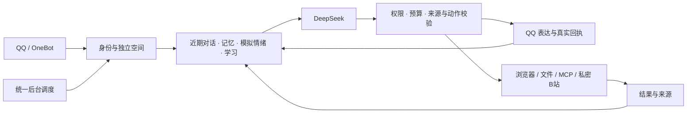

<div align="center">


### 让对话有延续，让表达有自己的节奏

**在一台 4GB ARM 小主机上，搭建有记忆、可学习、能主动交流的数字伙伴**

AstrBot · QQ / OneBot · DeepSeek · MCP · SQLite · Docker

[项目亮点](#为什么选择-p1-companion) · [方案对比](#相比常见部署方式优势在哪里) · [一键集成](#快速开始) · [AI 接入](#方便-ai-接手与协作) · [自修复](#连修复机制也有恢复路径) · [验证证据](#用证据说明能力) · [完整文档](#继续探索)

</div>

> **主要由 GPT 完成的工程实践。** 人类提出需求、提供设备与授权、反馈体验；OpenAI GPT 系列模型通过 ChatGPT / Codex 主导本项目新增工程的设计、编码、集成、排障、测试编排与文档。运行中的对话使用已配置的 **DeepSeek**。既有框架与第三方代码属于相应作者。[开发来源 →](AI_DEVELOPMENT.md)

## 为什么选择 P1 Companion

P1 Companion 把情绪状态、长期记忆、表达学习、群聊节奏和工具执行接到同一条运行链路。它关注一次互动之后留下了什么、下次该如何接续，以及什么时候值得主动开口。

| 优势 | 在项目里意味着什么 |
| :--- | :--- |
| **新手从零开始，跟着界面安装** | Windows 10/11 x64 双击启动，Linux 一个入口；自动准备 Docker、AstrBot、QQ 通道与 Companion，在网页填写 API、扫码并查看进度，验收后自动清理临时向导，后台与数据保留；原命令行入口保留 |
| **方便不同 AI 接手** | 提供 AGENTS.md、机器可读项目清单、零额外依赖 JSON CLI、可选只读 MCP 桥和交接模板；不绑定某个助手品牌 |
| **小设备，持续运行** | 已在 RK3399 / ARM64 / 4GB / Armbian 上部署验证。云端模型承担推理，本地保存状态、执行调度；重浏览与解析限制并发 |
| **情绪有延续，表达有依据** | 21 维有界模拟状态、不同变化速度、当前关切与表达策略共同参与生成；稳定人格与可学习习惯分开 |
| **每段关系，独立保存** | 按平台、机器人、私聊对象、群及群成员派生空间。新增白名单或群按需建状态，提权仍沿用自己的记忆 |
| **能学会，也能撤销** | 从明确反馈积累表达偏好和行为经验，保留逐字证据、有效期与修订记录；支持查看、忘记、回滚和暂停 |
| **能主动，也懂得停下** | 兴趣插话、后台活动、公开研究和提醒接入预算与发送保护；允许选择整理、休息或不发消息 |
| **连修复机制也能恢复** | 独立看门狗保护巡检、备份程序和定时器；原权限恢复、双份尝试账本、中断续接与新回执核验，升级本身也保留自动回滚路径 |
| **内存保护有边界** | 压力下暂停可选活动、保存登录再回收空闲浏览器；严格核对孤儿进程，保留原限额与回滚记录，[内存保护](docs/resource-guard.md) |
| **运行过程看得见** | 只读资源面板、来源记录、动作回执、学习状态、恢复点和故障验收记录，让行为与运行状态可以核对 |

### 对话之外，还能做什么

- **理解群聊的节奏**：结合发言人、引用、@、消息间隔和近期话题决定是否接话；各群使用独立上下文
- **自己探索资料**：在获准域名上搜索、读页、保留来源，围绕兴趣整理笔记，再判断是否值得分享
- **处理文件与产出资料**：有意提及时解析文档、使用 OCR，生成笔记、CSV、JSON 或静态 HTML；临时文件受配额与保留期限控制
- **整理私人 B站活动**：独立登录空间，支持私密收藏、稍后再看、播放记录和观察笔记；公开评论、弹幕保持禁用
- **使用 QQ 的表达方式**：短句分段、纯文本风格、审核表情素材，以及适配器支持的表态、本人撤回与受控转发
- **从已知故障恢复**：独立于模型的宿主巡检与看门狗，使用已验证的源码、镜像和数据库快照恢复服务；修复层自身也接受隔离故障验收

具体能力与未完成细节见 [二十项逐项复核](docs/twenty-item-audit.md)。例如当前检索使用本地轻量方法，经验学习不训练模型权重，自动修复仅覆盖列举并验收的恢复动作。

## 相比常见部署方式，优势在哪里

| 常见起点 | 原本擅长的事 | 本项目补上的整合 |
| :--- | :--- | :--- |
| **模型 API + 单个人格提示词** | 快速开始角色对话，调整语气 | 持久情绪状态、按对象隔离的记忆、可撤销学习，以及依据真实回执接续的互动 |
| **AstrBot + 自选插件组合** | 消息平台、模型、插件与 MCP 的灵活扩展 | 提供经过配套验证的配置、统一权限与主动发送保护，减少逐个接线、重复调度及上下文混用的排查工作 |
| **n8n 等工作流优先的搭建** | 连接服务、编排流程、暴露工具 | 在工作流之外接上持续的关系状态、群聊节奏和自然表达；保留 n8n 作为受控工具组件 |
| **按文档逐步手工部署** | 自由选择每个组件，适配复杂环境 | 标准布局可用一个入口完成预检、镜像构建、插件与服务安装、就绪检查和失败回滚；复杂布局保留手动路径 |
| **只用 restart 策略或存活检测** | 进程退出后拉起，快速发现不在线 | 进一步识别已封存文件与权限漂移，恢复巡检本身，限制重试，并用新的巡检回执确认恢复结果 |

**优势集中在“配套整合与可复现默认值”。** 上游 AstrBot 本身已有便捷部署、插件和 MCP；n8n 本身支持把工具和工作流接入 MCP。本项目在这些基础上，提供面向持续数字伙伴的状态、边界、部署和验收链路。对比不代表聊天效果、性能或成本全面优于其他方案。[AstrBot 官方 MCP 说明](https://docs.astrbot.app/use/mcp.html) · [n8n 官方 MCP 说明](https://docs.n8n.io/integrations/builtin/core-nodes/n8n-nodes-langchain.mcptrigger)

## 从一条消息，到下一次相遇



互动、共同事项和学习效果以真实来源与送达结果为依据。网页、附件和任务文本作为资料处理，不能赋予模型新权限；一次失败也不会被记作已经完成。

## 自主，但始终可控

| 你想调整什么 | 入口与边界 |
| :--- | :--- |
| 新增普通私聊 / 主人 | 现有主人私聊 `/加白 QQ号` 或 `/加主人 QQ号`；两者权限不同，[接入说明](docs/private-access-commands.md) |
| 让新群接入 | 主人 `/群聊 开启 群号`，再在本群 `/群内主动 开启`；新群默认关闭，[群控制](docs/group-control-fix.md) |
| 分开两种接话方式 | `/主动线路 原生 开启` 与 `/主动线路 P1 开启` 独立；兴趣、后台也有子开关，[线路说明](docs/reply-routes.md) |
| 看目标、额度或暂停活动 | `/自主空间 状态`、`/自主空间 暂停`、`/自主空间 恢复` |
| 审查与撤销学习 | `/学习 内容`、`/学习 效果`、`/学习 回滚 ID`，[学习说明](docs/self-learning.md) |
| 检查自动维护 | `/自修复 状态`、`/自修复 关闭`，[恢复流程](docs/recovery.md) |

两条接话线路共用同群上下文与发送保护，同一消息去重；实际发送保留 **2–5 秒延迟**、冷却、每日额度、免打扰和无人回复暂停。原生概率接话与另建的 AstrBot 定时 Agent 是不同功能，外部主动聊天插件也需单独协调。

### 自带轻量资源面板

**每 5 秒更新，保留最近 30 分钟趋势。** 查看 CPU / 各核心、可用内存、磁盘、温度、网络、ZRAM、8 个服务及模块巡检。面板使用系统 Python 标准库和静态页面，无需额外监控平台。

一次约 20 秒实测中，面板进程 RSS 合计约 **38 MiB**，CPU 约占整机 **0.18%**。这是短样本，不代表峰值或长期负载。页面只读，默认仅回环监听，通过 SSH 访问。[部署、统计口径与验证 →](docs/resource-panel.md)

## 连修复机制也有恢复路径

**模型停了，维护仍能运行；维护脚本坏了，独立看门狗还能尝试修复它。** 先整批校验 root 保护的恢复源，再恢复十个固定控制文件的内容与原权限。与部署共享锁，双份持久账本约束重试；中断后先查真实回执，避免重复启动。

看门狗升级也有私有恢复点和临时 systemd 回滚守护，失败时恢复旧源码与检查点。升级器不主动重启聊天容器，不操作聊天数据库。**42 项恢复链专项、26 项真实 Linux 隔离验收**覆盖文件缺失、权限漂移、定时器关闭、SIGKILL、账本损坏和升级回滚。

这套能力面向已经列举的故障，不代表任意代码错误都能自行修好。宿主机、systemd、磁盘或两个恢复执行层同时失效时仍需外部恢复；没有十年免维护保证。[设计、命令、故障证据与边界 →](docs/repair-chain.md)

## 快速开始

**不用预先安装 AstrBot。** 新安装向导把系统准备、AstrBot、QQ 接入和 Companion 串成六步；API、管理密码、QQ 与 B站扫码都在中文界面完成。当前向导为 Beta，实际验收层次与支持条件见 [完整说明](docs/installation-wizard.md)。

**Windows 10 / 11 x64：下载、解压、双击**

1. [下载完整 ZIP](https://github.com/RC-9246/p1-companion/archive/refs/heads/main.zip)，先解压
2. 双击 **开始安装.cmd**，按系统提示准备 WSL2；需要重启时保存工作，重启后双击桌面的继续安装入口
3. 在自动打开的网页填写 QQ 号、DeepSeek API Key 与管理密码，再按步骤扫码

程序创建独立的 P1Companion Ubuntu 环境，不接管原有 WSL，不需要安装 Docker Desktop。Windows 至少 8GB 内存 / 20GB 可用磁盘，推荐 16GB；CPU 虚拟化需要开启。

**Linux / Station P1：一个入口打开向导**

```sh
sudo bash install.sh
```

打开程序给出的本机链接。支持 Ubuntu 24.04、Debian 12/13 及对应 Armbian，ARM64 / x86_64。无桌面设备通过 SSH 隧道访问，[复制连接方法](docs/installation-wizard.md#linux--station-p1)。

向导自动生成 OneBot 连接、独立令牌、普通 / 快速 / 深度思考与识图配置，再构建与安装完整模块。开始安装前会明确提示合成 API 测试及其用量。账号注册、充值、扫码、安全验证与必要的 Windows 重启由本人完成；不绕过平台限制。后台自主社交默认关闭，维护与资源面板在试聊验收后按需一键安装。

<details>
<summary>已经有能正常聊天的 AstrBot？保留原命令行集成入口</summary>

```sh
python3 scripts/verify_source.py
python3 scripts/selftest.py
sudo bash deploy.sh --check
sudo bash deploy.sh --apply
```

这个旧入口专门集成到已有 AstrBot + SnowLuma + 模型；图形向导也提供“已有 AstrBot”选项。标准布局要求与回滚见 [集成说明](docs/easy-deploy.md)。已有 Companion 安装仍拒绝覆盖，升级使用专用流程。

</details>

**换成你自己的角色与素材**

本仓库提供 **中性人格与空图库**。你可以配置角色核心、表达基线及有权使用的审核素材，复现记忆、情绪、学习、群聊和工具机制。私人角色设定、关系阶段、真实聊天、账号、密钥、登录状态和原作图片不随源码分发。[人格与素材配置 →](docs/deployment.md#图片与人格)

## 方便 AI 接手与协作

**把项目结构、操作入口和验收边界一起交给下一位助手。** 有文件与终端能力的 AI 可以直接读取 `AGENTS.md` 和机器清单，用一条命令了解项目：

```sh
python3 ai/companion.py describe
```

- **无需额外依赖的 JSON CLI**：源码核验、部署计划、只读诊断、运行摘要与交接模板，输出便于工具解析
- **可选 MCP 工程桥**：6 个只读工具、2 个 resource、1 个接手 prompt；默认仅源码信息，运行摘要须显式配置目标目录
- **模型无关的交接**：明确区分观察、推断、未验证和下一步，减少每次重新梳理项目的成本
- **工程权限与角色人格分开**：不改日常聊天模型与人格，不把 QQ 或 B站账号工具自动开放给外部助手

支持范围取决于助手本身是否能读取文件、运行 Python 或连接 MCP。桥本身没有部署、重启、Shell、聊天发送或数据库查询工具；真实机器和账号操作仍依据实际用户授权。这里提供兼容入口，不代表所有品牌与版本都已实机验证。[AI 接入指南](docs/ai-access.md) · [可复制接手提示](ai/TAKEOVER.md) · [机器清单](ai/PROJECT.json)

## 用证据说明能力

| 已有记录 | 能说明什么 |
| :--- | :--- |
| **407 项完整离线测试** | 当前生产分支的离线回归结果，包含新增 42 项恢复链专项；包含角色或素材相关检查，不能代替新机器验收 |
| **图形向导专项** | 空白主机配置、密钥不进进度记录、真实本机 HTTP 权限检查、原有部署保护，以及 Windows 语法 / 计划 / 参数转发分别记录，见 [向导验证](evidence/installation-wizard-validation.json) |
| **27 项安装器专项** | 启动门、互斥、校验、旧安装拒绝，以及模拟 Docker 下十个阶段的失败恢复；另有 Linux 临时目录中的真实文件与权限验收，见 [部署验证](evidence/easy-deploy-validation.json) |
| **AI 接入专项** | 默认权限、字段过滤、过期状态、源码核验与交接格式有独立回归；MCP 真实握手另行记录，见 [验证结果](evidence/ai-access-validation.json) |
| **198 项中性核心测试** | 可用 `python3 scripts/selftest.py` 复现的当前中性核心检查 |
| **41 项隔离故障验收** | 临时文件、合成数据库与隔离容器上的恢复测试，见 [故障记录](evidence/isolated-repair-acceptance.json) |
| **26 项真实恢复链验收** | 独立 systemd 单元、真实 SIGKILL、升级提交/失败/回滚；八个生产容器前后保持不变，[验收记录](evidence/repair-chain-isolated.json) |
| **原生 SDK 与范围矩阵** | 在临时数据和替身传输中核对命令、权限、记忆空间、发送与撤权行为 |
| **真实服务与模型专项** | 各专项分别记录部署、公开网站、合成模型请求及回执，不以容器运行冒充账号在线 |

仓库同时保留实现、测试、去敏结果与已知缺口。**20 个方向都有工程对应，部分细节仍待补齐或真实动作验收。** 长期自然程度、自主可靠性与十年稳定运行属于持续验证目标。[验收报告](docs/release-report.md) · [逐项审计](docs/twenty-item-audit.md) · [资源面板实测](evidence/resource-panel-postflight.json)

## 仓库地图

```text
release/       八个插件：情绪、记忆、学习、群聊、表达与自主活动
browser/       公开资料浏览器与访问策略
services/      B站、文件解析与实验、MCP、维护、资源面板
AGENTS.md      AI 工程协作指南，不替代角色人格
ai/            项目清单、JSON CLI、只读 MCP 与交接模板
开始安装.cmd   Windows 10/11 x64：准备独立 WSL2 并打开向导
install.sh     Linux：准备 Python 并打开图形向导
deploy.sh      原受检集成入口（已有 AstrBot）
deploy/        图形向导、空白主机准备、安装协调与失败恢复
scripts/       原有安装、源码核验、素材注册、检查点与恢复
tests/         离线、原生 SDK、服务、模型与隔离故障验收
docs/          设计、部署、控制、排障与适用边界
evidence/      去敏的测试与部署结果
```

## 继续探索

| 想了解 | 从这里开始 |
| :--- | :--- |
| 复现与定制 | [图形安装](docs/installation-wizard.md) · [已有 AstrBot 集成](docs/easy-deploy.md) · [部署指南](docs/deployment.md) · [操作控制](docs/controls.md) · [人格与情绪设计](docs/emotion-design.md) |
| AI 接手与协作 | [接入指南](docs/ai-access.md) · [工程指南](AGENTS.md) · [交接提示](ai/TAKEOVER.md) |
| 记忆与学习 | [独立记忆空间](docs/memory-spaces.md) · [持续学习](docs/self-learning.md) · [连续表达](docs/self-response.md) |
| 群聊与图片 | [群控制](docs/group-control-fix.md) · [主动线路](docs/reply-routes.md) · [延迟优化](docs/group-latency.md) · [图片输入](docs/group-image-fix.md) |
| 运行与恢复 | [实时面板](docs/resource-panel.md) · [恢复手册](docs/recovery.md) · [最终验收](docs/release-report.md) |
| 工程过程与后续方向 | [实施过程](docs/development-history.md) · [功能矩阵](docs/feature-matrix.md) · [逐项缺口](docs/twenty-item-audit.md) · [后续能力](docs/further-capabilities.md) |

## 使用边界与来源

本项目适合愿意维护 Linux / Docker、重视可追溯行为的小规模自托管实验。部署时需要自己管理模型费用、QQ 与 B站账号风险、参与者隐私及第三方授权。它是实验性数字伙伴系统；“情绪”“自主”“学习”指软件机制，不代表已证实的主观情感。未知逻辑缺陷、硬件、账号风控与外部 API 变化仍需管理员处理。

项目为独立社区工程，无 OpenAI、DeepSeek、腾讯、哔哩哔哩或作品权利人的官方背书。未为整包第三方代码重新授予统一许可证；Memoria 上游许可尚未确认，公开再分发前应取得适当许可或排除相关代码。免责声明不能补足缺失授权，也不免除依法不能免除的责任。

[完整免责声明与使用条款](DISCLAIMER.md) · [开发来源](AI_DEVELOPMENT.md) · [第三方归属与许可](PROVENANCE.md) · [适用边界](docs/boundaries.md)
