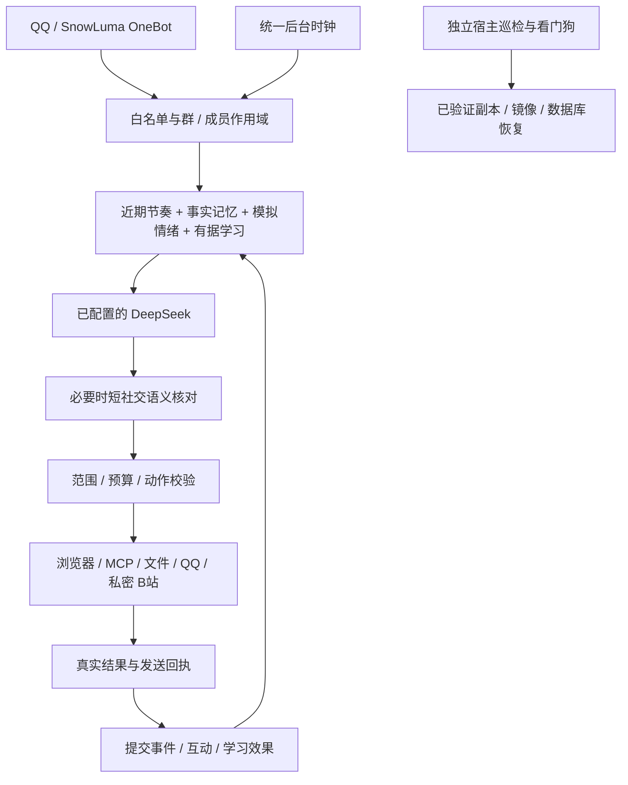

# P1 Companion — 可复现的持续运行数字伙伴

**本项目主要由 GPT 完成。** 人类提出目标、提供设备与授权、反馈体验；OpenAI GPT 系列模型通过 ChatGPT / Codex 承担本项目新增工程的主要设计、编码、集成、排障、测试编排、文档与工具部署工作。既有框架和第三方代码保留各自作者归属；部署后的日常推理使用已配置的 DeepSeek，不因开发来源而变成 GPT。详见 [开发来源与贡献说明](AI_DEVELOPMENT.md)。

**安装或授予权限前，请阅读 [完整免责声明、风险披露与使用条款](DISCLAIMER.md)。** 这是实验性工程，不承诺零故障、十年免维护、账号永不封禁或AI输出必然正确。主动交流、云端模型和登录工具可能涉及他人隐私、对外行为及实际费用，需由有权主体依法授权；免责不替代授权、安全措施或软件许可，也不免除依法不能免除的责任。

AstrBot + SnowLuma/OneBot + 已配置的DeepSeek，增加独立记忆/情绪/学习、群聊理解、统一主动交流、自主目标、公开研究、私密B站整理、文件理解、有界实验、MCP和自修复。

这是中性人格交付。私人角色提示词、具体关系阶段、账号/密钥、数据库、原始对话和第三方图片没有进入此目录。兼容API中保留的 `saki` 名称是历史标识，不表示随包附带原人格。生产验收与中性版本验收分别记录，不能相互替代。

## 原计划完成度

20个方向都有代码对应，但部分只有基础实现或尚缺真实动作验收，不能称所有细节全部完成。请先看[二十项逐项复核与缺口](docs/twenty-item-audit.md)，其中记录本次发现并修复的公开研究预算故障，以及尚未补齐的功能细节。历史测试通过、容器健康与长期自主可靠性分别说明。

## 整体流程



`release/` 是八个插件；`browser/` 是公开只读浏览器；`services/` 包括独立B站、解析与实验、MCP及维护；`scripts/` 提供中性安装、校验与恢复；`tests/` 区分离线、原生组件、真实服务、真实模型与故障注入；`docs/` 解释设计和边界；`evidence/` 保存去敏结果。

先验证 source-manifest：`python3 scripts/verify_source.py`。它只核对源码，不连接账号或读取运行数据。

## 复现前提

已测试：RK3399/ARM64、4GB、Armbian、Docker Compose、AstrBot 4.29.1、MCP SDK 1.30.0。使用现有DeepSeek客户端；不同模型对thinking/max的兼容性应先核验。常驻组件适合小规模白名单和少量群；重浏览/解析串行运行。

先按上游文档完成 [AstrBot](https://docs.astrbot.app/) 与SnowLuma的QQ登录和OneBot连接，容器分别命名 `astrbot` / `snowluma`，平台ID为 `qq_snowluma`。将AstrBot持久目录放在 `/srv/p1-agent/astrbot/data`，其原生 `cmd_config.json` 已存在，模型可正常聊天。本项目不提供QQ账号、密钥、验证码绕过或平台登录替代方案。

## 快速安装

在仓库目录执行，先查看安装预览，再使用同样参数加 `--apply`。替换下面的示例QQ号。

```sh
python3 scripts/bootstrap.py --root /srv/p1-agent --bot-id 10001 --owner-id 20002
sudo python3 scripts/bootstrap.py --root /srv/p1-agent --bot-id 10001 --owner-id 20002 --apply
```

`--friend-id`可重复添加；`--enable-social`开启获准范围自主社交；`--cross-forward allow`允许过滤后的跨范围转发。默认不开启后台社交。安装器备份原插件、原生配置和已有数据库；源代码/配置回滚用 `scripts/restore.py 恢复点 --apply`，数据库保留，生成本机内部令牌，不打印令牌，不自动重启机器人。已存在的人类权限文件保持原样，不能靠重新安装悄悄扩大权限。

安装依赖后构建公共浏览器与解析器。基础镜像和依赖版本在Dockerfile及requirements-tested.txt中；不要拿旧版私有P1镜像名当作已经存在的公开镜像。

```sh
docker build -t p1-companion-browser:0.20.0 browser
docker build -t p1-companion-workbench:0.20.0 services/workbench
docker compose -p p1-companion -f /srv/p1-agent/public-browser/compose.yaml up -d
docker network connect p1-companion-control astrbot
docker compose -p p1-workbench -f /srv/p1-agent/astrbot/data/companion_services/workbench/compose.yaml up -d
docker compose -p p1-leisure -f /srv/p1-agent/astrbot/data/companion_services/leisure/compose.yaml up -d
```

`p1-companion-control`由公共浏览器Compose创建为内部网络，无新增公网端口。AstrBot内需安装requirements-tested.txt列出的兼容Python依赖；推荐使用扩展镜像固定版本，避免容器重建后丢依赖。公共页面和私人B站分开代理，不混用Cookie。

首次n8n仅在没有既有workflow.db时运行：`sudo python3 scripts/setup_workflows.py`。安装器根目录不同于默认时，需同时将该脚本常量调整为同一目录。随后运行 `scripts/secure_workflows.py` 关闭初始owner设置页。只创建一个读取公开Python文档的审核工作流，不接邮箱/日历、不开放任意工作流编辑或系统命令。

确认服务健康后重启AstrBot，让其加载插件、MCP和原生白名单。需要max主动思考时，在AstrBot中复制已核验的DeepSeek provider，ID使用 `deepseek-max/deepseek-flash`，启用其thinking与 `reasoning_effort=max`；模型能力以实际服务返回为准，输出长度独立控制。

本次有依据的角色反应、短期延续和新旧对照的结果与局限见 [连续表达说明](docs/self-response.md)。

## 图片与人格

默认图库为空，文字/记忆/情绪/工具正常工作。用自己有权使用且亲自检查过的jpg/png注册图片：

```sh
python3 scripts/add_asset.py my_image.png --label '轻松微笑' --tags '微笑,轻松' --category 轻松 --reviewed
```

每张1KB–1MB、最多64张；文件摘要、画面标签、来源与重复限制由后端核对。重新安装插件后生效。项目不打包原作插画或动画剧照。

人格配置在 `release/astrbot_plugin_affect/persona.md` 与 friend_persona.md；私人表达基线在relationship_style.py，公开人格在group_chat.py及group_affect的PROFILE；自定义称呼还需调整group_chat.py的NAME与路由说明。稳定人格与可学习表达分离，群友和网页不能重写核心。修改之后先测试、再更新恢复检查点，避免自修复恢复为上一已验证版本。

## 使用与验证

B站首次登录：主人私聊发送 `/B站 登录`，用手机扫码后发送 `/B站 状态` 核验；`/B站 额度` 查看日预算。新域名使用 `/浏览授权 域名`，再由主人直接 `/浏览确认 验证码`。这些操作不把权限交给网页。

仅 @ 机器人曾被框架当作空消息跳过，现已补上；说明与验证见 [仅 @ 回复修复](docs/bare-mention-fix.md)。

主人命令：`/群聊 开启 群号`、`/群内主动 开启 群号`、`/自主空间 状态`、`/自主空间 暂停`、`/自修复 状态`。所有群默认关闭，主人命令核对机器人真实群目录；各私聊、群和群成员独立建空间。主人也可在已启用的群内直接发送 `/群内主动 开启`、`/群内主动 关闭`、`/群内主动 状态`，仅作用于本群；其他群成员不能改开关。

离线中性核心检查：`python3 scripts/selftest.py`。在安装了AstrBot SDK的隔离环境可运行 `tests/integration_agency.py`、`tests/integration_scope_matrix.py` 和 `tests/integration_group_control.py`，使用临时数据库与替身传输，不发真实QQ、不调用真实模型。图片/人物专用的旧生产评测仅作参考，不用于证明中性安装已经覆盖该人物。

真实模型、真实公共网站、真实登录、真实QQ分别验收。合成传输通过不能声称真实QQ已经送达。完整生产299×5轮、41项隔离故障矩阵、16种文件格式和真实模型合成评测见evidence与文档；历史中性核心132项另行验证；本次中性核心161项，详见连续表达说明；中性分支另有portable验收结果。

## 自修复安装

先完成原生与真实服务验收，然后运行 `sudo python3 scripts/install_maintenance.py --root /srv/p1-agent --apply`。安装器要求八个服务健康、插件就绪、原AstrBot/SnowLuma的Compose存在，才安装宿主机巡检与看门狗并封存本机源码、辅助文件、内部令牌和镜像ID。它保留已有健康检查/备份脚本；首次中性安装若没有这些脚本，会生成保守的容器健康检查与30天数据库快照工具。账号是否已登录仍需另外真实核验。未完成这些条件时自修复timer保持关闭，核心聊天不依赖它。

`/自修复 关闭`保留人工控制。恢复只使用已验证源码/镜像/数据库、冷却与次数限制，不接受模型生成的任意生产命令。离机备份、主机无法启动、硬件、电源、磁盘、Docker守护进程、账号验证码和外部API变更仍需管理员维护；十年是设计目标，非承诺。

## 文档、来源与边界

[GPT开发来源](AI_DEVELOPMENT.md)、[完整免责与使用条款](DISCLAIMER.md)、[最终验收报告](docs/release-report.md)、[完整实施过程](docs/development-history.md)、[后续方向](docs/further-capabilities.md)、[二十项功能](docs/feature-matrix.md)、[记忆空间](docs/memory-spaces.md)、[情绪设计](docs/emotion-design.md)、[持续学习](docs/self-learning.md)、[控制](docs/controls.md)、[恢复](docs/recovery.md)、[适用边界](docs/boundaries.md)、[来源](PROVENANCE.md)。各上游适配的UPSTREAM与LICENSE保留原路径。未为整包第三方代码重新授予统一许可证；Memoria上游许可证尚未确认，公开再分发前应取得适当许可或排除相关代码，免责条款不能补足授权。

本项目没有连接Windows/Android/iPhone控制、邮箱、日历、付款和任意系统Shell。公共网页只是资料，无法访问时不假称读完；B站公开评论/弹幕禁用；OCR不保证全部视觉隐私，未知原图不跨范围转发。当前模型费用由使用者账号承担，日志、导出与缓存不应收集无关私聊。


## 新安装的隔离验收

先完成上面的镜像构建，再为测试设置专用标签。测试启动的容器名带 `neutral` / `lab`，使用临时目录；B站验收无网络、无账号、无生产数据挂载。不要把测试里的模拟QQ号当作真实联系人。

```sh
docker tag p1-companion-browser:0.20.0 p1-companion-neutral-browser:0.20.0
docker tag p1-companion-workbench:0.20.0 p1-companion-neutral-workbench:0.20.0
sudo python3 tests/portable_leisure_install.py
```

这项测试从全新目录安装，删除并恢复代码与内部令牌，再以UID1001启动浏览器代理与B站服务；它核对恢复后的可读性，未证明账号已登录或视频已完整理解。公共浏览器/解析器另有 `tests/portable_images_live.py`；真实QQ、模型与账号验收分别完成。默认AstrBot容器沿用已测试上游镜像的root运行方式；若自行改为非root或部署多个实例，需要另外调整数据目录权限、容器/网络名称与宿主机单元并重新验收。

群内开关入口修复与专项验收：[说明与边界](docs/group-control-fix.md)。


最近修复：[图片来源混淆排查](docs/image-provenance-incident.md)。当前附件、历史图片、引用、助手配图与后台视频观察分别处理；已核实错误的助手回复可按范围精确撤回，保留原始聊天记录。此检查不能保证消除所有模型幻觉。

群聊本轮图与同群引用图的输入修复、验证和适用边界见 [群聊图片说明](docs/group-image-fix.md)。

原生概率接话与 P1 智能主动的独立开关：[主动线路控制](docs/reply-routes.md)。

群内主动接话排队和模型参数优化：[延迟修复、复现与测量边界](docs/group-latency.md)。

QQ 快捷接入：现有主人私聊 `/加白 QQ号` 或 `/加主人 QQ号`，详见[权限命令、隔离和恢复](docs/private-access-commands.md)。

P1 本机每5秒更新的只读资源面板：[查看、部署与开销说明](docs/resource-panel.md)。
