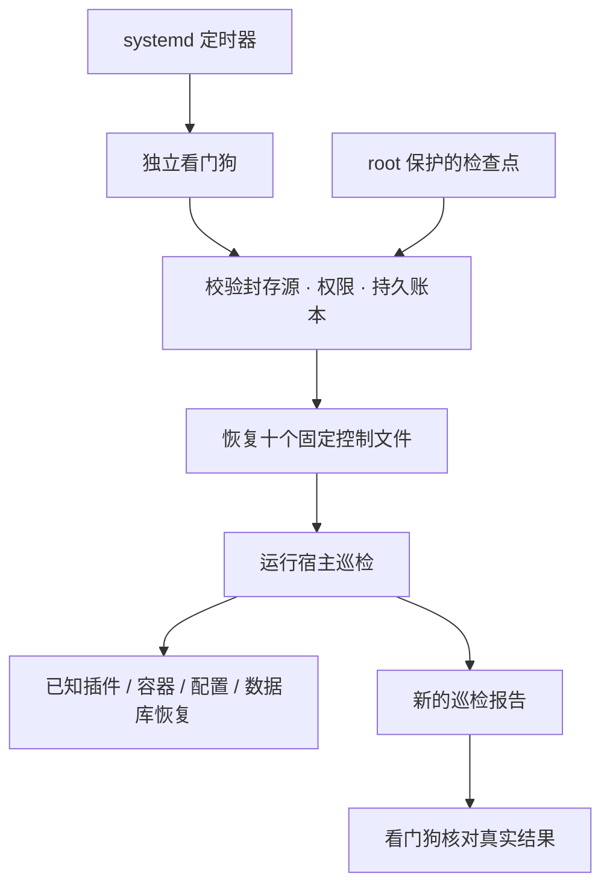

# 故障恢复之外，再保护恢复机制

[← 项目首页](../README.md) · [完整恢复范围](recovery.md)

P1 Companion 的宿主机巡检负责已知的插件、容器、配置和数据库故障。独立看门狗再检查巡检程序及其定时器：模型不可用、巡检脚本丢失或权限被改坏时，恢复路径仍有机会工作。此层仅用 Python 标准库，不调用模型，不发送消息，不新增公网端口。

## 这次增强了什么

| 机制 | 实际行为 |
| --- | --- |
| 十个固定恢复对象 | 巡检、看门狗、恢复库、健康检查、两个备份程序及四个 systemd 单元；不接受模型指定路径或命令 |
| 整批检查恢复源 | 先校验全部十项的 root 所有权、SHA-256、权限元数据，以及 Python 编译或单元基本结构；任一不可信则本轮不替换目标文件 |
| 原权限恢复 | 同时比较字节、UID、GID、权限位。内容未变但权限漂移也会修复；拒绝符号链接父路径，目标叶节点的链接可安全替换 |
| 互斥与原子替换 | 与巡检、部署共享 `maintenance.lock`，文件先写临时副本再替换；启动巡检前释放共享锁，结束后重新取得并校验检查点代次 |
| 持久尝试账本 | 两份带序号和校验的账本，先记录尝试再执行。单份损坏可续接；双份损坏或初始化后双份丢失时停止动作，不借重置额度反复重启 |
| 有限重试 | 滚动 24 小时最多两次新的恢复机制修复，冷却 30 分钟；未完成的一次允许续接一次。同一开机周期用单调时间计算间隔 |
| 成功需要回执 | 文件与权限匹配、两个定时器开启、oneshot 成功结束，并出现新的有效巡检报告。命令退出 0 或旧报告都不能单独证明修复成功 |
| 升级也有恢复点 | 独立升级协调器备份三个源码副本与封存检查点；安装临时 systemd 回滚守护，升级未提交且进程丢失时可恢复旧版本 |
| AI 可查看摘要 | 工程 CLI / MCP 读取固定状态文件，输出封闭状态码、待验收标记和尝试数；不返回私有路径、原始日志或聊天数据 |

两份账本不等于两台机器的冗余，SHA-256 也不等于发布者签名。上述校验不能抵御已经取得 root 权限的攻击者。

## 和原有巡检的关系



主巡检约每三分钟运行，看门狗约每十分钟运行。看门狗损坏但主巡检仍正常时，主巡检可从同一封存副本恢复它；主巡检脚本损坏时，看门狗可修复主巡检。**两个执行层同时损坏、systemd 或宿主机无法启动时，仍需外部恢复。**

新账本限制的是“恢复机制自身”的修复轮次。原主巡检对每个容器仍沿用三次失败门槛、30 分钟冷却和每日两次服务修复；不能把新账本描述成所有文件、数据库动作的统一事务或全局次数限制。

每次自动恢复仍受主人暂停标记控制。后台模型不能修改这套 root 级动作清单、账本预算、密钥或系统权限。主巡检报告里的应用健康状态和“修复引擎恢复成功”分别记录，不把其中一项当成全部应用正常。

## 使用与观察

首次安装先按 [部署指南](deployment.md) 完成真实服务验收，再安装宿主维护；这不是默认开启的一键安装步骤。现有维护安装可使用专用升级器，避免重装聊天插件：

```sh
# 仓库内：只显示升级范围，不修改机器
python3 scripts/upgrade_repair_chain.py --root /srv/p1-agent

# 已有有效维护检查点、三个受支持布局的源码副本时，由获授权管理员执行
sudo python3 scripts/upgrade_repair_chain.py --root /srv/p1-agent --apply

# 宿主机：只读检查封存源、目标文件、单元与账本
sudo python3 /usr/local/sbin/p1-companion-watchdog.py --check

# 有权读取目标状态的工程助手可取摘要
python3 ai/companion.py status --root /srv/p1-agent
```

`--check` 不初始化账本、不写健康报告、不执行修复。`ok` 表示检查可以完成；另看 `needs_repair`、`planned_files`、`pending` 与 `paused`。不要仅凭退出码判断完全健康。

状态文件为 `astrbot/data/plugin_data/affect/repair_watchdog_health.json`。`healthy` 表示当次未发现需要动作的问题；`repair_succeeded` 和 `pending_recovery_verified` 表示通过修复回执核验。`busy` 是让出部署/巡检锁，`deferred_verification` 是等待后续核验，`cooldown` / `daily_budget_exhausted` 是受到重试限制。`checkpoint_rejected`、`journal_corrupt`、`clock_guard` 等状态需要管理员排查，不应删除账本来绕过限制。摘要超过 20 分钟后状态返回 unknown，维护摘要自己的有效期仍为 15 分钟。

QQ 主人 `/自修复 关闭` 或 `maintenance.disabled` 标记暂停自动维护。它不能撤销已经开始的外部动作；维护时先暂停并等待当前 oneshot 结束。看门狗恢复文件后按原服务约束重新启动巡检，不重放未知 QQ 发送。

## 升级回滚

升级器只修改三个看门狗源码副本和检查点中的看门狗条目。支持标准安装目录，也兼容早期部署使用中性测试目录保存辅助源码的已知布局；不扫描并写入任意路径。它先保存 root 私有恢复点、暂停两个维护定时器、等待已运行任务结束，并取得共享锁；校验新源码与恢复定时器状态后才提交。**不会主动重启机器人，也不操作 SQL 或恢复聊天数据库。** 恢复定时器后原巡检会继续自己的正常工作。

未提交的升级由临时持久 systemd 守护接续：同一启动周期、原进程仍活着且未超时则不干预；进程丢失、期限到达或重启后可尝试回滚。提交后删除临时守护。若发现不属于这次升级的后续源码或检查点变化，则拒绝覆盖并要求人工核对。不要把“可在重启后运行的恢复入口”写成“已经做过整机断电测试”。

管理员可用升级器返回的真实恢复点回滚：

```sh
sudo python3 scripts/upgrade_repair_chain.py --root /srv/p1-agent \
  --rollback /srv/p1-agent/backups/recovery-chain-实际时间与标识
```

此恢复点包含完整封存检查点，可能含令牌、私人配置与源码。仅保存在目标机受保护的备份目录，**不能上传公开仓库**。本地备份仍应配合经过验证的离机备份；回滚会保留聊天数据库。

## 可复现的验收

```sh
# 临时文件与替身 systemd，无需 root，无网络或模型请求
python3 -m unittest discover -s tests -p 'test_repair_*.py'

# Linux + root + systemd + 已运行的配套八容器，仅对独立临时单元故障注入
sudo python3 tests/repair_chain_acceptance.py

# 另测合成数据库与隔离容器；使用现有本地工作台镜像
sudo python3 tests/isolated_repair_acceptance.py
```

恢复链专项 42 个离线测试已在 macOS 与 Linux ARM64 通过，真实 Linux 故障验收 26 项。真实验收使用独立文件及有唯一前缀的 systemd 单元，实际删除、改权限、关闭定时器、制造失败 oneshot，并两次 SIGKILL 看门狗子进程、一次 SIGKILL 升级子进程。升级提交、人工回滚、验收失败自动回滚和持久回滚入口均实际运行；测试前后比较八个生产容器的启动时间与重启次数。没有生产数据挂载、真实 QQ 测试消息或模型请求。重试时间窗用注入的 uptime 偏移加速，未修改 OS 时钟，也未整机重启。

结果：[26 项真实恢复链验收](../evidence/repair-chain-isolated.json) · [原有隔离恢复验收](../evidence/isolated-repair-acceptance.json) · [版本验证与生产核对](../evidence/repair-chain-validation.json)。

## 适用边界

这是“对已经识别并验收的故障自动恢复”的实现。它不让模型任意改生产代码，不会自动拉最新镜像、重开账号权限、猜测未知 API 或替用户处理验证码。未知程序逻辑错误、宿主机或磁盘损坏、备份不可读、平台封禁和第三方接口变化仍可能需要人工处理。长期稳定运行需要持续升级、容量管理与恢复演练，不提供十年免维护或零故障保证。
